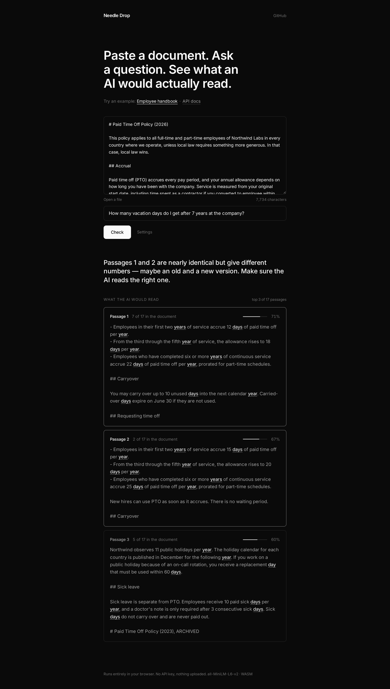
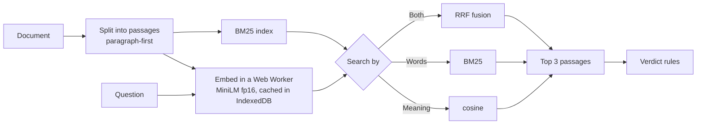

# Needle Drop

**Paste a document. Ask a question. See what an AI would actually read.**

**Live:** https://gfxroy.github.io/needle-drop/



Most "chat with your docs" bugs happen before the LLM writes a word: the retriever hands it the wrong passages. Needle Drop shows you exactly which 3 passages a typical RAG pipeline would pick for your question, how strongly each one matches, which of your words they contain, and one plain-English verdict about what went wrong.

Everything runs in your browser. No API key, no server, nothing uploaded.

## What it does

- **Paste or drop** a `.txt` / `.md` document, or load one of two example documents (an employee handbook, an API reference).
- **Check** splits the document into passages, embeds them with a real sentence-embedding model (`all-MiniLM-L6-v2`, running locally via transformers.js and ONNX Runtime Web, WebGPU when available, WASM otherwise), and retrieves the top 3.
- Each passage has a **match bar**, with the question's words **underlined**.
- **The verdict** is one line, for example:
  - *Your answer is most likely in passage 1.*
  - *"E4021" appears in the document, but not in these passages. Try searching by Both.* (embeddings blur exact codes)
  - *Passages 1 and 2 are nearly identical but give different numbers.* (an old and a new version of a policy)
  - *The answer looks split across passages 1 and 2. Try Medium passages.* (the passage boundary cut through the answer)
  - *Nothing here matches the question well.*

  When it can, the verdict comes with a one-click fix.
- **Settings** (optional): passage size (small / medium / large) and search by **Words** (BM25), **Meaning** (embeddings) or **Both** (reciprocal rank fusion).

## How it works



- `src/lib/chunkers.ts` splits on paragraphs first, then sentences and words. "Large" stays under the model's 256-token window, so nothing is silently truncated.
- `src/lib/retrieve.ts` runs dense, BM25 and RRF hybrid ranking.
- `src/lib/verdict.ts` holds the verdict rules: unretrieved exact codes, near-duplicate passages (shingle Jaccard), answers split across a mid-paragraph boundary, weak matches.
- **One finding from building it:** the default 8-bit quantised MiniLM export in the browser is badly degraded. Some texts get cosine ≈ 0 against the fp32 model, and results change with batch composition. The fp16 weights match fp32 at cosine 1.000, so Needle Drop uses fp16.

### Offline evaluation

`npx tsx scripts/eval.ts` runs the same pipeline in Node with the same model. It uses 20 labelled questions over the two example documents and tries all 9 settings, checking how often the passage holding the answer makes the top 3:

| Passage size | Words | Meaning | Both |
|---|---|---|---|
| Small | 85% | 95% | 95% |
| Medium | 100% | 85% | 100% |
| Large | 95% | 95% | 100% |

## Local development

```bash
npm install
npm run dev        # http://localhost:5173
npm test           # vitest
npm run lint && npm run typecheck && npm run build
```

## Limitations

- The first visit downloads about 45 MB of model weights. They are cached after that.
- The verdicts are heuristics, not ground truth. "Found" points at the strongest passage. It does not check that the passage really answers the question.
- English-centric tokenizer and stemmer. Plain text and Markdown only.

## License

MIT © 2026 Aaditya Roy
